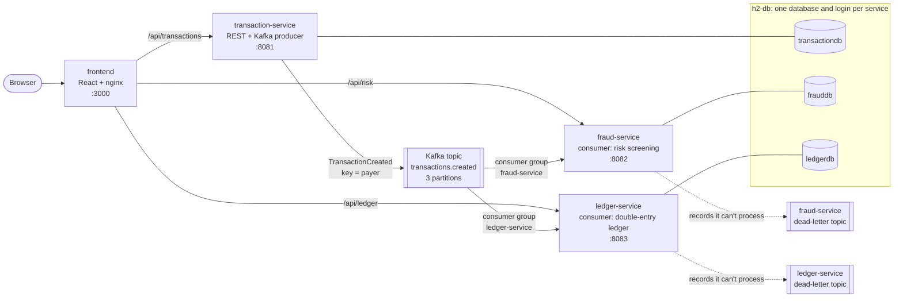

# Kafka Payments Demo

[](https://github.com/scottman256/kafka-example/actions/workflows/ci.yml)

An event-driven microservices demo built with **Apache Kafka**, **Spring Boot** and **React**.
A user enters a financial transaction in a single-page app. A producer service records it
and publishes a `TransactionCreated` event. Two independent consumer services react to it:

- **fraud-service:** risk and compliance screening (fraud and AML rules, risk score)
- **ledger-service:** double-entry ledger, account balances and per-bank outflows

The whole environment runs with Docker Compose: 6 containers, each service owning its own
database. See [docs/DESIGN.md](docs/DESIGN.md) for the full design.

**Contents:** [Architecture](#architecture) · [Run it](#run-it) · [Demo walkthrough](#demo-walkthrough) ·
[Design decisions and trade-offs](#design-decisions-and-trade-offs) · [Talking points](#talking-points) ·
[Explore each service](#explore-each-service) · [Run the tests](#run-the-tests) ·
[Continuous integration](#continuous-integration) · [Poke at the infrastructure](#poke-at-the-infrastructure)

## Architecture



1. The browser only talks to nginx, which serves the React app and forwards each `/api/*`
   prefix to its service.
2. transaction-service saves the transaction, publishes one `TransactionCreated` event keyed by
   payer, and returns the partition and offset it landed on.
3. fraud-service and ledger-service read that same event in their own consumer groups, each
   keeping its own offsets and its own database. The services never call each other.

## Built with AI assistance

This solution was co-authored with **Claude Opus 5.5**, Anthropic's AI model, working in
Claude Code. I set the requirements and coding standards, chose among the design options,
and directed the build one part at a time. Claude drafted the design and wrote the code
with me. Every commit we made together carries a `Co-Authored-By: Claude Opus 5.5` trailer.
The standards Claude follows in this repo are in [CLAUDE.md](CLAUDE.md).

## Build status

| Part | Scope | Status |
|---|---|---|
| 1 | Infrastructure: Kafka (KRaft) + H2 server + Compose | ✅ Done |
| 2 | transaction-service (producer) | ✅ Done |
| 3 | fraud-service (consumer) | ✅ Done |
| 4 | ledger-service (consumer) | ✅ Done |
| 5 | React frontend | ✅ Done |
| 6 | End-to-end integration, resilience demo, docs | ✅ Done |

## Prerequisites

- **Docker Desktop** (Compose v2). The containers are capped at about 5 GB of memory in total
  and use about 1.6 GB after a fresh start.
- **Python 3** to run the demo scripts in `scripts/`. They only use the standard library.
- JDK 17 and Node.js 22.12 or later are needed only for building and testing outside Docker.
  Gradle is not needed, because each service has its own wrapper.

## Run it

```bash
docker compose up -d --build --wait
```

`--wait` returns once every container is healthy. The first build downloads Gradle and npm
dependencies and takes a few minutes. After that, a cold start from empty volumes takes about
half a minute.

| What | Where |
|---|---|
| **The web app** | **http://localhost:3000** |
| transaction-service API | http://localhost:8081/api/transactions |
| fraud-service API | http://localhost:8082/api/risk/assessments |
| ledger-service API | http://localhost:8083/api/ledger/accounts |
| Kafka (from your machine) | `localhost:29092` |
| Kafka (from containers) | `kafka:9092` |
| H2 web console | http://localhost:8090 |
| H2 JDBC (from your machine) | `jdbc:h2:tcp://localhost:9090/<db>` |

Each service has its own database and login (values are in [.env](.env)):

| Database | User | Password |
|---|---|---|
| `transactiondb` | `transaction_svc` | `transaction_demo_pw` |
| `frauddb` | `fraud_svc` | `fraud_demo_pw` |
| `ledgerdb` | `ledger_svc` | `ledger_demo_pw` |

To sign in to the H2 console, use the JDBC URL `jdbc:h2:tcp://localhost:9090/transactiondb`
(or `frauddb` / `ledgerdb`) with that database's user and password. One service's login is
rejected by the other databases.

Stop everything with `docker compose down`. Add `-v` to also delete the Kafka and H2 data.

If you'd rather use an API client than curl, [services/bruno](services/bruno/README.md) has a
[Bruno](https://www.usebruno.com) collection with every API.

## Demo walkthrough

### 1. Send a transaction from the web app

Open http://localhost:3000. Fill in the form, or pick a **demo scenario** to fill it with a case
that trips a fraud rule, and send it. The result card shows the Kafka topic, partition, offset
and key the transaction was published with. Within two seconds it appears in all three live
panels: the transaction itself, fraud-service's risk score and rules, and ledger-service's
updated balances and trial balance.

Send the **Velocity burst** scenario four times: all four land on the same partition, because
they share a payer, and only the fourth is flagged.

### 2. Run the scripted demo

```bash
python scripts/demo.py
```

It sends nine payments that between them trip every fraud rule, waits for both consumers, and
prints what each one did:

```
Scenario            Payment                                    Published to Kafka     Risk       Rules triggered
------------------  -----------------------------------------  ---------------------  ---------  --------------------------------------------------------
Everyday purchase   Alice Smith -> Bob's Hardware  $125.50     partition 2, offset 0  LOW 0      -
Just under $10,000  Nina Patel -> Cash Exchange Co  $9,500.00  partition 2, offset 1  MEDIUM 45  POSSIBLE_STRUCTURING, NEW_PAYEE_HIGH_VALUE
Large payment       Grace Hopper -> Acme Motors  $15,000.00    partition 1, offset 0  MEDIUM 55  LARGE_AMOUNT, NEW_PAYEE_HIGH_VALUE
Self-payment        Mallory Black -> Mallory Black  $9,500.00  partition 1, offset 1  HIGH 95    POSSIBLE_STRUCTURING, SELF_PAYMENT, NEW_PAYEE_HIGH_VALUE
Future-dated        Frank Ocean -> Landlord LLC  $1,200.00     partition 1, offset 2  MEDIUM 35  NEW_PAYEE_HIGH_VALUE, DATE_ANOMALY
Velocity burst      Victor Quick -> Coffee Shop  $4.50         partition 2, offset 2  LOW 0      -
...
Velocity burst      Victor Quick -> Coffee Shop  $4.50         partition 2, offset 5  MEDIUM 30  HIGH_VELOCITY

Ledger: 13 accounts; debit and credit balances both $25,885.50, so the trial balance nets to zero.
```

### 3. Stop a consumer and watch it catch up

This is Kafka's core selling point: a consumer that goes down loses nothing, because the broker
keeps its place.

```bash
python scripts/resilience_demo.py
```

```
1. Stopping ledger-service. fraud-service keeps running.
2. Sending 3 payments to Resilience Store 4d3b0d while it is down
   partition 1, offset 3: screened by fraud-service (LOW)
   partition 1, offset 4: screened by fraud-service (LOW)
   partition 0, offset 1: screened by fraud-service (LOW)
   ledger-service is 3 events behind: Kafka holds them until it comes back
3. Starting ledger-service again
4. ledger-service caught up from its committed offset in 10s, including startup:
   all 3 payments posted, lag 0
   The trial balance still nets to zero.
```

To do it by hand instead: run `docker compose stop ledger-service`, then send a few payments in
the web app. The Ledger panel says it can't reach ledger-service while the other two panels
keep updating. Check the lag:

```bash
docker compose exec kafka /opt/kafka/bin/kafka-consumer-groups.sh \
  --bootstrap-server kafka:9092 --describe --group ledger-service
```

Then run `docker compose start ledger-service` and watch the Ledger panel fill in.

### 4. Send a record that can never be processed

```bash
docker compose exec kafka bash -c "echo 'this is not json' | /opt/kafka/bin/kafka-console-producer.sh \
  --bootstrap-server kafka:9092 --topic transactions.created"

docker compose exec kafka /opt/kafka/bin/kafka-console-consumer.sh --bootstrap-server kafka:9092 \
  --topic transactions.created.fraud-service.DLT --from-beginning --formatter-property print.headers=true
```

Each consumer moves the record straight to its own dead-letter topic, with `kafka_dlt-*` headers
saying why, and carries on with the next record. Press Ctrl+C to stop reading.

### 5. See the dual-write trade-off

Run `docker compose stop kafka` and send a payment. Within about 10 seconds transaction-service
answers 503: the transaction is saved, but its publish log entry is `FAILED`. Run
`docker compose start kafka` afterwards. The [design decisions](#design-decisions-and-trade-offs)
explain why this happens and what would fix it.

## Design decisions and trade-offs

| Decision | Why | Trade-off |
|---|---|---|
| Save the transaction, then publish, recording the outcome in a publish log | Simple, and the API can say exactly where the event landed | A crash or broker outage between the two leaves a saved but unpublished transaction. A transactional outbox would close the gap. |
| Key every event by payer | One payer's events stay in order on one partition, which the velocity rule relies on | A payee can be paid from any partition, so the ledger has to lock rows to avoid lost updates. |
| At-least-once delivery with idempotent consumers | A unique event id per stored row turns a redelivery into a no-op | Simpler than Kafka transactions, but every consumer must keep the check. |
| Fraud rules use event time, not the clock | Catching up on a backlog gives the same scores as processing it live | Depends on per-payer ordering, which the key choice provides. |
| Each service keeps its own copy of the event and ignores unknown fields | No shared library: services deploy independently, and the producer can add fields | Contract drift isn't caught at compile time. The end-to-end CI jobs catch it instead; a schema registry would be stronger. |
| A dead-letter topic per consumer group | A bad record never blocks a partition, and each consumer fails independently | Dead letters need a separate process to inspect and replay them, which isn't built yet. |
| Ledger postings lock accounts in name order, then the bank | No lost updates and no deadlocks when partitions share accounts | Postings to a busy account queue up behind each other. |
| H2 in server mode and a single Kafka broker | A small, quick stack that runs on a laptop | Not production-grade: no replication, and H2 rather than PostgreSQL. |
| The UI polls each service every 2 seconds | Simple, and needs nothing beyond nginx | Up to 2 seconds of delay. Server-sent events would push updates instead. |
| nginx looks service names up on every request | The page loads while a service is down, and follows a restarted service to its new IP | A DNS lookup every 10 seconds, which is negligible here. |

## Talking points

Questions this project answers, with where to see each answer:

- **What happens if a consumer goes down?** Its committed offset stays put and new events wait
  in the topic. When it restarts it resumes from that offset and catches up.
  `scripts/resilience_demo.py` shows it, and CI runs it on every pull request.
- **What if Kafka delivers an event twice?** Both consumers store the event id with a unique
  constraint and skip one they've already handled. Each consumer has an integration test that
  redelivers an event and checks it isn't processed twice.
- **What if an event can't be processed?** Malformed or incomplete events go straight to the
  consumer's dead-letter topic. Other failures retry 3 times with backoff first. Either way the
  partition keeps moving. See walkthrough step 4.
- **What if Kafka is down when a user submits?** transaction-service saves the transaction, fails
  to publish within about 10 seconds, and returns 503 with the transaction id. The publish log
  records the failure. A transactional outbox would retry it automatically.
- **How is ordering guaranteed?** Events are keyed by normalized payer, so one payer's events share
  a partition and arrive in order. The velocity rule depends on this.
- **How do two services get the same event?** Each is its own consumer group with its own offsets.
  Adding a third consumer needs no change to the producer.
- **How does the ledger stay correct when partitions share accounts?** Row locks, always taken in
  the same order. A test sends 30 concurrent payments to one payee; with the locks removed, it
  lost 11 of them.
- **How would this scale?** Add partitions and run more instances per consumer group; Kafka
  spreads the partitions across them. The row locks still protect shared accounts across
  instances. The databases would move to PostgreSQL.
- **How are the services kept independent?** A database and login per service, no HTTP calls
  between services, and no shared code. Each owns its copy of the event contract.
- **How is it tested?** Unit, web, JPA and embedded-Kafka tests per service, all at 100%
  coverage with a 90% gate. CI also runs end-to-end tests against the full Docker Compose
  stack: a smoke test, the scripted and resilience demos, and Playwright browser tests.

## Explore each service

### Transaction service

```bash
# Create a transaction. The response includes the Kafka topic, partition, offset and key.
curl -i -X POST http://localhost:8081/api/transactions \
  -H "Content-Type: application/json" \
  -d '{"transactionDate":"2026-10-30","payer":"Alice Smith","payee":"Bobs Hardware",
       "amount":125.50,"memo":"Lumber for deck","sourceBank":"First National Bank"}'

curl http://localhost:8081/api/transactions                # recent transactions, newest first
curl http://localhost:8081/api/transactions/<id>           # one transaction
curl http://localhost:8081/api/transactions/source-banks   # banks accepted by validation
```

Responses:

| Case | Status | Body |
|---|---|---|
| Saved and published | `201 Created` | The transaction, plus `kafka` details (status, partition, offset, key, payload) |
| Invalid input | `400 Bad Request` | Problem detail with a `fieldErrors` map |
| Kafka unreachable | `503 Service Unavailable` within about 10s | Problem detail with the `transactionId`. The transaction is saved, and its publish log entry is `FAILED`. |

### Fraud service

fraud-service reads every `TransactionCreated` event and scores it against six fraud and AML
rules:

| Try | Rules triggered | Score |
|---|---|---|
| Payer and payee the same, $9,500 | `POSSIBLE_STRUCTURING`, `SELF_PAYMENT`, `NEW_PAYEE_HIGH_VALUE` | 95 HIGH |
| $15,000 to a new payee | `LARGE_AMOUNT`, `NEW_PAYEE_HIGH_VALUE` | 55 MEDIUM |
| Four small payments by one payer in a row | the 4th triggers `HIGH_VELOCITY` | 30 MEDIUM |
| Transaction date three weeks in the future | `DATE_ANOMALY` (plus `NEW_PAYEE_HIGH_VALUE` if over $1,000) | 20+ |

```bash
curl http://localhost:8082/api/risk/assessments          # newest first, with triggered rules
curl http://localhost:8082/api/risk/assessments/<txn-id> # one transaction's assessment
curl http://localhost:8082/api/risk/alerts               # MEDIUM and HIGH only
```

Each assessment records the partition and offset it was read from.

### Ledger service

ledger-service posts each event as a journal entry: a debit on the payer's account and an equal
credit on the payee's.

```bash
curl http://localhost:8083/api/ledger/accounts                           # every balance
curl "http://localhost:8083/api/ledger/accounts/Bob's%20Hardware/entries"  # one account's lines
curl http://localhost:8083/api/ledger/banks                              # outflow per source bank
curl http://localhost:8083/api/ledger/trial-balance                      # must net to 0.00
```

A payer's balance goes down and the payee's goes up by the same amount, so the trial balance
always nets to zero.

## Run the tests

```bash
cd services/transaction-service && ./gradlew check   # 60 tests
cd services/fraud-service && ./gradlew check         # 77 tests
cd services/ledger-service && ./gradlew check        # 60 tests
cd frontend && npm ci && npm run check               # 75 tests
```

Each service has unit tests, web and JPA slice tests, and a full-stack test against an
embedded Kafka broker. Both consumer suites cover redelivery (idempotency) and the
dead-letter topic. The ledger suite also sends 30 concurrent payments to one payee and
checks that no update is lost. The frontend's `check` type-checks the app, then runs Vitest
and React Testing Library tests against a fake API.

`check` also runs a coverage gate in every project: the build fails if line coverage drops
below 90%. All four are currently at 100%. The reports are in each service's
`build/reports/jacoco/test/html/index.html` and in `frontend/coverage/index.html`.

Against the running stack:

- `python scripts/smoke_test.py` posts one transaction and waits for both consumers to process it.
- The [Playwright tests](playwright/README.md) drive the web app in a browser: they send payments
  and demo scenarios and wait for each one to reach all three panels.

## Continuous integration

Every pull request to `main` runs the [CI workflow](.github/workflows/ci.yml) in GitHub Actions.
A first **Detect changes** job works out what the pull request touched, and each later job runs
only if its part of the repo changed:

| Job | Runs when | What it does |
|---|---|---|
| Tests and coverage (*service*) | that service changed | `./gradlew check`: every test plus the 90% coverage gate |
| Tests and coverage (frontend) | `frontend/` changed | `npm run check`: type-check, tests and the 90% coverage gate |
| End-to-end (Docker Compose) | anything other than docs changed | builds and starts the whole stack, then runs the smoke test, the scripted demo and the resilience demo through the web app's proxy |
| End-to-end (Playwright) | anything other than docs changed | builds and starts the whole stack, then runs the [Playwright browser tests](playwright/README.md) |

Markdown files and the Bruno collection never trigger tests on their own. A change to the
pipeline itself runs every job. Coverage figures appear in each job's summary.

`main` is protected: a pull request can only be merged when every check has passed or been
skipped as unaffected.

## Poke at the infrastructure

```bash
# List topics
docker compose exec kafka /opt/kafka/bin/kafka-topics.sh --bootstrap-server kafka:9092 --list

# Watch the transactions topic (Ctrl+C to stop)
docker compose exec kafka /opt/kafka/bin/kafka-console-consumer.sh \
  --bootstrap-server kafka:9092 --topic transactions.created --from-beginning \
  --formatter-property print.key=true --formatter-property print.partition=true \
  --formatter-property print.offset=true

# Each consumer group's position on each partition
docker compose exec kafka /opt/kafka/bin/kafka-consumer-groups.sh \
  --bootstrap-server kafka:9092 --describe --all-groups
```

> On Git Bash for Windows, put `MSYS_NO_PATHCONV=1` in front of these commands so the
> `/opt/...` paths aren't rewritten.

Topics:

| Topic | Partitions | Purpose |
|---|---|---|
| `transactions.created` | 3 | Main event stream, keyed by payer |
| `transactions.created.fraud-service.DLT` | 3 | Dead letters from fraud-service |
| `transactions.created.ledger-service.DLT` | 3 | Dead letters from ledger-service |

Every container has a health check, a restart policy and a memory limit. The Java services
start only after Kafka and H2 are healthy. The web app starts straight away, so it can show
which service is unreachable.
